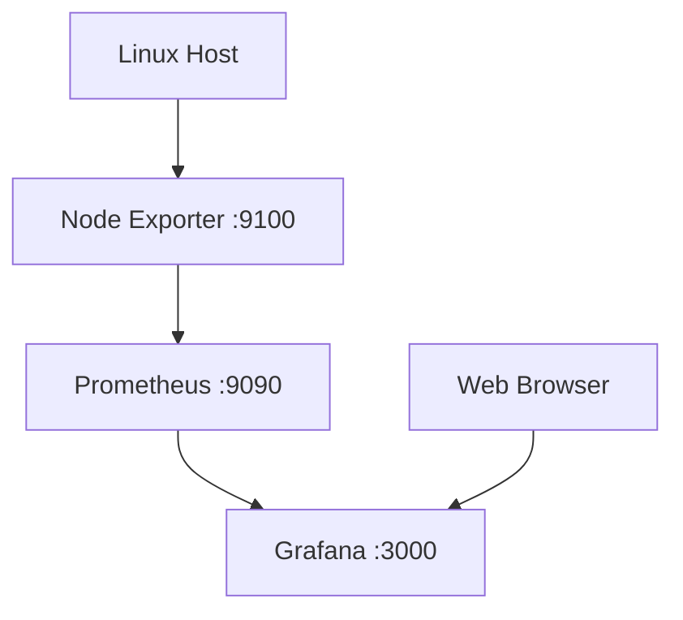

# Infrastructure Monitoring Lab

## Project Overview

A lightweight Linux host monitoring stack built with Docker Compose, Prometheus, Node Exporter, and Grafana.

## Architecture

## Technology Stack

| Technology | Purpose |
|---|---|
| Docker Compose | Service orchestration |
| Prometheus | Metrics collection and storage |
| Node Exporter | Linux host metrics |
| Grafana | Monitoring dashboards |

## Monitored Metrics

- CPU usage
- Memory utilization
- Filesystem capacity
- Network receive and transmit traffic

## Network and Security

- Prometheus is exposed on localhost port 9090.
- Grafana is exposed on localhost port 3000.
- Node Exporter is accessible internally through the Docker network.
- Prometheus and Grafana use persistent Docker volumes.
- Prometheus data retention is configured for 7 days.

## Resource Limits

| Service | Memory Limit |
|---|---:|
| Prometheus | 256 MiB |
| Grafana | 256 MiB |
| Node Exporter | 64 MiB |

## Validation Results

| Test | Result |
|---|---|
| Docker Compose configuration | Passed |
| Prometheus target: prometheus | UP |
| Prometheus target: node-exporter | UP |
| Grafana health endpoint | OK |
| CPU, memory, filesystem, and network metrics | Available |

## Current Limitations

- Monitoring currently focuses on Linux host metrics.
- Docker container-level monitoring is not yet implemented.
- MySQL-specific monitoring is not yet implemented.

## Future Improvements

- Add Docker container metrics.
- Integrate MySQL monitoring.
- Create custom Grafana dashboards.
- Add alerting rules and notifications.
